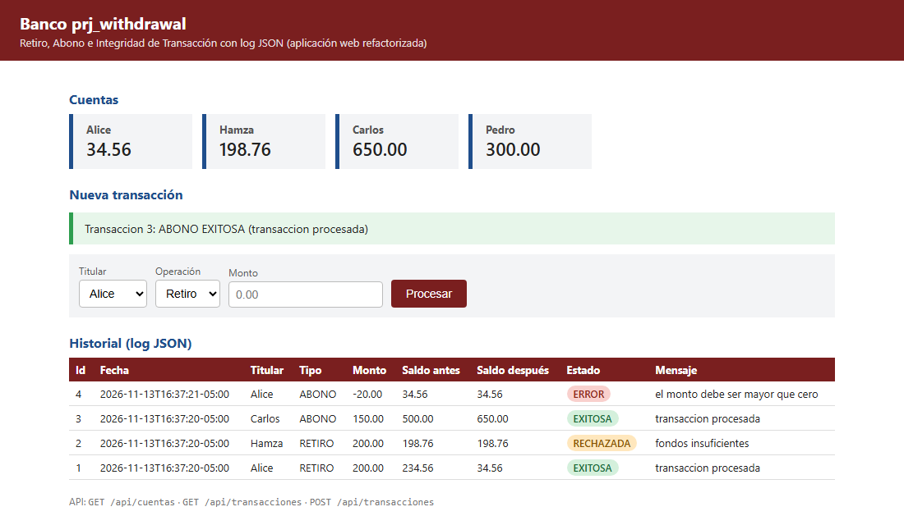

# prj_withdrawal_web

Una app que permite **retirar** y **abonar** dinero en unas cuentas de ejemplo
y deja un **historial** de todo lo que se intenta, tenga éxito o no.

Es un proyecto que fue creciendo por etapas, hecho en el lenguaje **Go**
y descrito con escenarios en lenguaje natural (Gherkin / BDD)

## Imagen de la Aplicacion



## ¿Qué hace?

- **Retirar** dinero de una cuenta (solo si hay saldo suficiente).
- **Abonar** dinero a una cuenta (solo montos mayores que cero).
- **Guardar un historial** de cada intento, con fecha, monto, saldos y resultado:
  - **EXITOSA**: la operación se hizo y el saldo cambió.
  - **RECHAZADA**: no se hizo porque no había saldo suficiente.
  - **ERROR**: no se hizo porque el monto no era válido (cero o negativo).
- **No perder datos**: el historial se guarda en un archivo y, al volver a abrir el programa,
  los saldos se recuperan solos.
- Si por algún motivo no se puede guardar el historial, la operación se **deshace**:
  o se hace todo o no se hace nada.

Cuentas de ejemplo: Alice (234.56), Hamza (198.76), Carlos (500.00) y Pedro (300.00).

## ¿Qué contiene este proyecto?

| Carpeta o archivo | Para qué sirve |
|---|---|
| `webbank/` | El programa principal: es lo que se ejecuta para abrir la página. |
| `internal/banco/` | Las reglas del banco: cuentas, retiros, abonos y el historial. |
| `internal/web/` | La página web y las direcciones que el navegador usa. |
| `features/` | Los escenarios escritos en lenguaje natural (qué debe pasar en cada caso). |
| `README.md` | Esta guía. |

## ¿Cómo se ejecuta?

**1. Instalar Go** (solo la primera vez): descargarlo desde <https://go.dev/dl> (versión 1.22 o superior)
e instalarlo. No hay que instalar nada más.

**2. Abrir una terminal** (PowerShell, CMD o Terminal) dentro de la carpeta del proyecto,
la que contiene el archivo `go.mod`.

**3. Escribir este comando:**

```bash
go run ./webbank
```

**4. Abrir el navegador** en <http://localhost:8080>.

## ¿Cómo se usa la página?

1. Arriba se ven las **cuentas** con su saldo actual.
2. En **Nueva transacción** se elige el titular, si es **Retiro** o **Abono**, y el monto.
3. Al presionar **Procesar**, aparece un mensaje con el resultado.
4. Abajo, el **Historial** muestra todos los intentos (los más recientes primero).

Ejemplos para probar:

| Qué hacer | Resultado esperado |
|---|---|
| Alice retira 200 | EXITOSA (le quedan 34.56) |
| Hamza retira 200 | RECHAZADA (solo tiene 198.76) |
| Carlos abona 150 | EXITOSA (pasa a 650.00) |
| Alice abona -20 | ERROR (el monto debe ser mayor que cero) |

El historial se guarda en `data/transacciones.json`; se crea solo la primera vez.
Para empezar de cero, basta con borrar la carpeta `data` con el programa cerrado.

## ¿Cómo se comprueba que funciona bien?

El proyecto trae pruebas automáticas que revisan los casos de los escenarios (retiro, abono,
historial, deshacer si falla el guardado, varios usuarios a la vez y la página web).
Para correrlas:

```bash
go test ./... -count=1
```

Si todo está bien, cada línea termina en `ok`.

